<div align="center">


# Vislo

**Um visualizador de imagens rápido e minimalista para Windows.**<br/>
Dê dois cliques numa foto e ela já está na tela. Navegue pela pasta, dê zoom de 1% a 10.000% e deixe o app se atualizar sozinho.

[](https://github.com/juninmd/vislo/releases/latest)
[](https://github.com/juninmd/vislo/actions/workflows/release.yml)
[](https://github.com/juninmd/vislo/actions/workflows/validate.yml)
[](https://github.com/juninmd/vislo/releases)
[](https://tauri.app)
[](https://www.rust-lang.org)
[](LICENSE)

<br/>

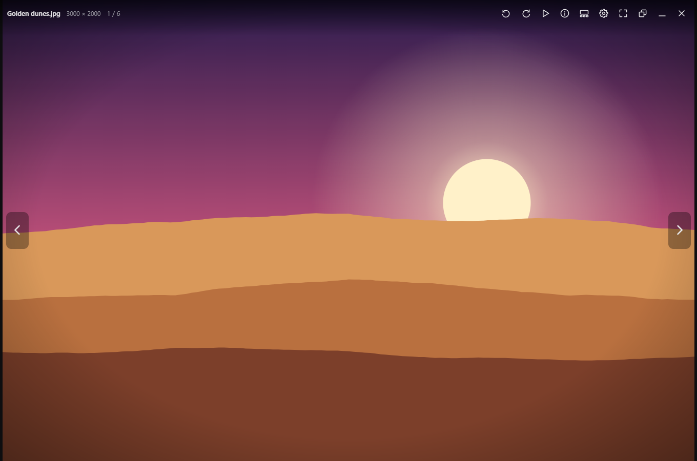

</div>

> **Dê dois cliques numa foto e ela já está na tela.** Folheie a pasta com as setas e dê zoom de 1% a 10.000% com a roda do mouse.

---

## O que é

Vislo é um app desktop (Tauri 2: backend em Rust, interface em TypeScript sem framework) para quem só quer **abrir uma
imagem e folhear a pasta dela**, sem biblioteca, sem edição e sem importação. Ele ataca a lentidão dos visualizadores
pesados: uma janela nativa mostra a imagem decodificada enquanto o WebView2 ainda está subindo, e um modo residente
reabre arquivos em dezenas de milissegundos. O escopo é pequeno de propósito: **ver ao abrir**.

## Índice

[Funcionalidades](#funcionalidades) · [Tour](#tour) · [Instalação](#instalação) · [Uso](#uso) ·
[Arquitetura](#arquitetura) · [Idiomas](#idiomas) · [Atualização automática](#atualização-automática) · [Atalhos](#atalhos-de-teclado-e-mouse) ·
[Desempenho](#por-que-é-rápido) · [Configuração](#configuração) · [Desenvolvimento](#desenvolvimento) ·
[Gates de CI](#gates-de-ci) · [Contribuindo](#contribuindo) · [Segurança](#segurança) · [Limitações](#limitações-conhecidas) ·
[Licença](#licença)

## Funcionalidades

* **Instantâneo.** Primeira tela em cerca de 100 ms para imagens típicas; o modo *keep ready* (residente na bandeja)
  reduz a reabertura para dezenas de milissegundos.
* **Fluido.** Animações suaves de slide, pré-carregamento antecipado, filmstrip 3D e um zoom que não dá saltos; menus, painéis,
  banner e filmstrip entram e saem com fade (só `opacity`/`transform`, sem layout) e respeitam "reduzir movimento".
* **Abre quase tudo.** JPEG, PNG, GIF, WebP, AVIF, SVG, JPEG XL, JPEG 2000, BMP, TIFF, PSD, HDR, EXR, 30 tipos de RAW de câmera e mais.
* **14 idiomas.** Inglês, português (Brasil), espanhol, francês, alemão, italiano, russo, turco, japonês, coreano, chinês
  simplificado e tradicional, polonês e holandês; segue o idioma do sistema ou troca em *Settings &rarr; Language*, na hora.
* **Autoatualizável.** Novas versões são encontradas, verificadas e instaladas a partir deste repositório, com um clique.
* **Abre maximizado**, sem barra de título, sobre fundo transparente escurecido; a barra superior move a janela e
  alterna entre maximizado e janela do tamanho da imagem (`F11` é tela cheia de verdade). *Settings &rarr; Open maximized* desliga isso.
* **Navegação por pasta** na ordem do Explorer (`img2` antes de `img10`), com slides animados.
* **Zoom de 1% a 10.000%** no cursor (roda, pinça ou `+` `-`); a partir de 400% os pixels aparecem como quadrados nítidos.
  Arrastar move a imagem em qualquer zoom; duplo clique alterna ajustar e 100%. Respeita "reduzir movimento" do sistema.
* **Redução nítida:** fotos exibidas muito menores que seus pixels são reamostradas com Lanczos em Rust.
* **Apresentação de slides** (`S` / `F5`): tela cheia, 4 s por imagem e 1 s de cross-fade por padrão, em loop.
* **Girar a visualização** (`R` / `Shift+R`) e tamanho em pixels ao lado do nome e no título da janela.
* **Muitos formatos:** JPEG (inclui JIF/JFI/PJPEG), PNG/APNG, GIF, WebP, BMP/DIB, AVIF/AVIFS, ICO/CUR, **SVG** (vetor, nítido em
  qualquer zoom), **JPEG XL** e **JPEG 2000** (JP2, J2K, J2C, JPC; decodificadores em Rust puro), TIFF, TGA (+ VDA, ICB, VST), PSD,
  Netpbm (PBM/PGM/PPM/PNM/PAM), Radiance HDR e OpenEXR (com tone-mapping para sRGB), DDS (DXT), QOI, farbfeld e o JPEG
  embutido de 30 tipos de RAW (DNG, CR2, CR3, CRW, NEF, NRW, ARW, SRF, SR2, ORF, RW2, RAF, PEF, SRW, X3F, 3FR, FFF,
  IIQ, MEF, MOS, MRW, DCR, KDC, ERF, RWL, RAW, ARQ, GPR, ORI, K25). A orientação EXIF é aplicada.
* **Keep ready** (configuração, desligado por padrão): fechar a janela estaciona o Vislo na bandeja em vez de sair;
  *Start ready when I sign in* cria uma entrada Run por usuário (`vislo.exe --background`).
* **Sempre sincronizado:** arquivos criados ou apagados no Explorer aparecem quando a janela recupera o foco;
  apagar a imagem exibida abre a vizinha.
* **Decodificação robusta:** imagens enormes ou corrompidas são recusadas com mensagem, sem derrubar o app.
* **Visualizador padrão:** registra-se para os tipos de imagem que você marcar.
* **Painel de configurações** (ícone de engrenagem): roda, tela cheia ao iniciar, controles que somem, fundo
  (escuro / preto / transparente), redução nítida, prévia instantânea, filmstrip 3D, prévia ao passar o mouse,
  tempos da apresentação, modo bandeja e atualizações. Salvo na pasta de configuração do app.

## Tour

<table>
<tr>
<td width="50%">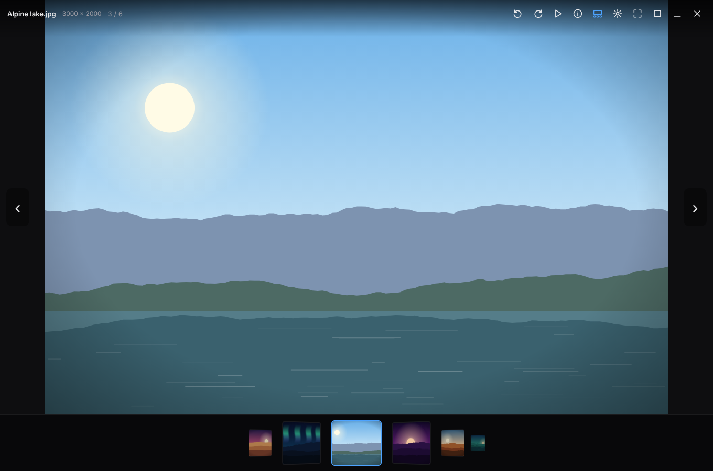<br/><b>Filmstrip 3D</b> (<kbd>T</kbd>) &ndash; miniaturas geradas em Rust, em cache no disco, com animação contínua e prévia ampliada ao passar o mouse.</td>
<td width="50%">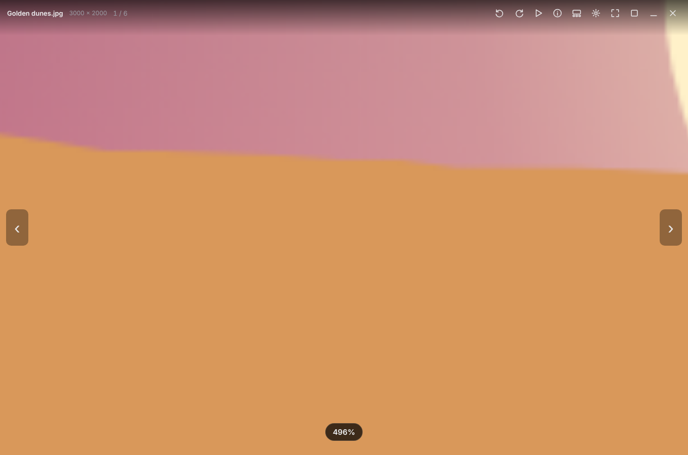<br/><b>Zoom 1% &rarr; 10.000%</b> &ndash; roda, pinça ou <kbd>+</kbd> <kbd>-</kbd> no cursor; pixels nítidos a partir de 400%.</td>
</tr>
<tr>
<td width="50%">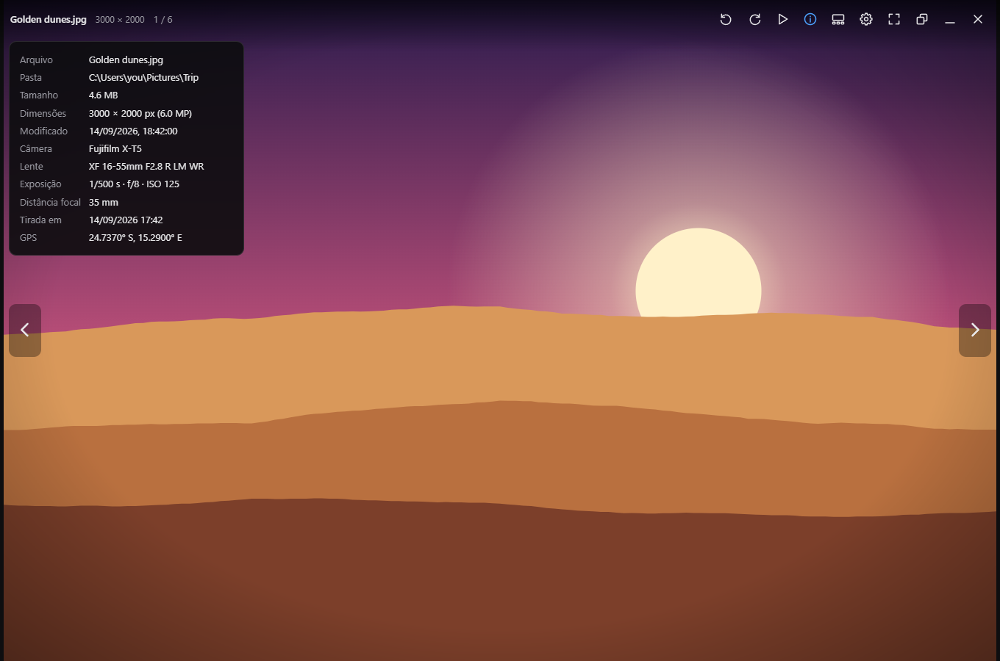<br/><b>Painel de informações</b> (<kbd>I</kbd>) &ndash; agrupado em arquivo (formato, criação, modificação), imagem (dimensões, proporção, cor, resolução, espaço de cor), câmera, exposição (programa, medição, balanço de branco, flash), autoria e local (GPS, altitude, direção). Traduzido para o idioma escolhido; um clique no valor o copia.</td>
<td width="50%">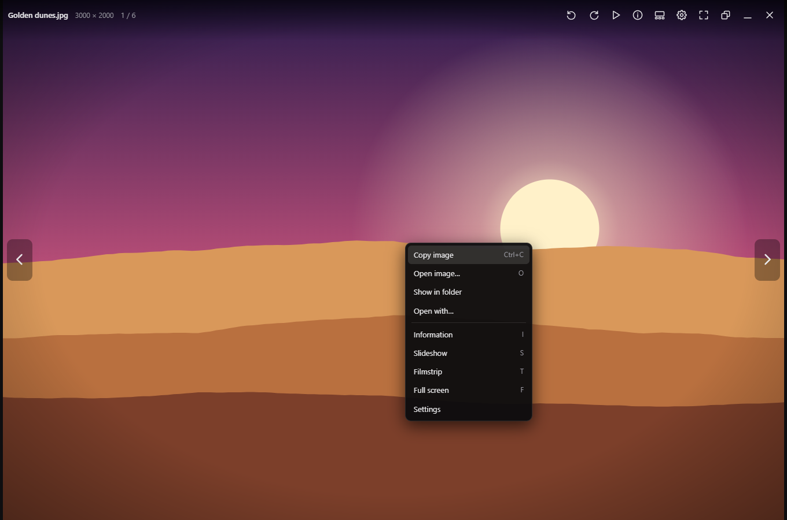<br/><b>Menu do botão direito</b> &ndash; copiar, abrir, mostrar na pasta, abrir com, apresentação e mais.</td>
</tr>
<tr>
<td width="50%">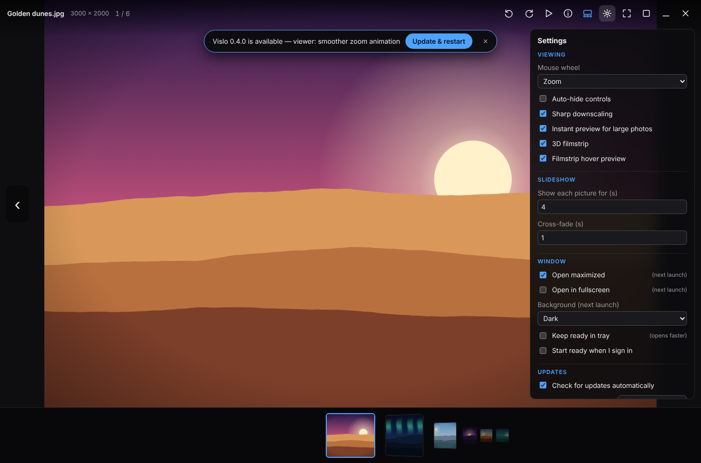<br/><b>Configurações e atualizações</b> &ndash; um banner oferece novas versões; um clique baixa, verifica e reinicia.</td>
<td width="50%">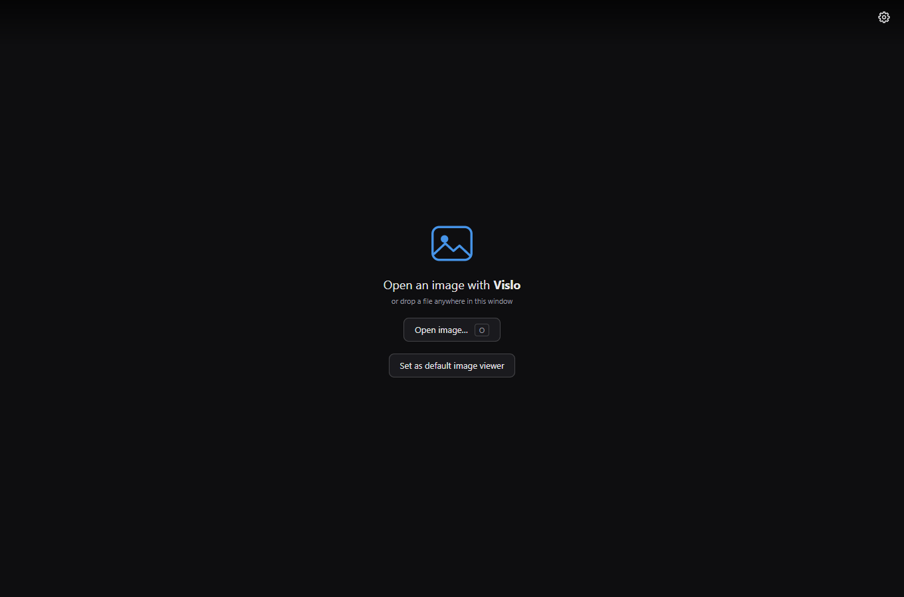<br/><b>Solte um arquivo</b> em qualquer lugar, aperte <kbd>O</kbd> ou torne o Vislo o visualizador padrão.</td>
</tr>
<tr>
<td colspan="2">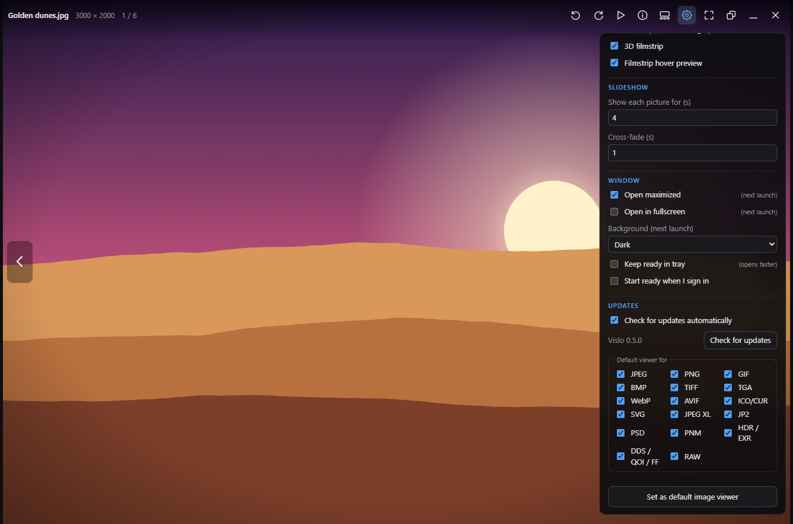<br/><b>Visualizador padrão por grupo de formato</b> &ndash; marque só o que o Vislo deve abrir (JPEG, PNG, SVG, JPEG XL, JPEG 2000, RAW, ...).</td>
</tr>
</table>

As telas acima são renderizadas a partir do frontend real rodando contra um backend Tauri simulado e fotos desenhadas
proceduralmente (`scripts/screenshots/`), então são reproduzíveis e não usam imagens de terceiros.

## Instalação

1. Baixe **`Vislo_<versão>_x64-setup.exe`** da [última release](https://github.com/juninmd/vislo/releases/latest)
   (ou o `-portable.exe`, se preferir sem instalador) e execute. Não exige administrador.
2. Clique em *Set as default image viewer* na tela vazia ou no painel de configurações. O Windows pede que você confirme
   em *Configurações &rarr; Aplicativos padrão* (ele não deixa apps assumirem padrões silenciosamente).

Plataforma suportada: Windows x64 com WebView2.

> [!WARNING]
> O instalador não é assinado digitalmente (o workflow de release não assina binários), então o Windows pode mostrar
> um aviso de editor desconhecido antes de executar.

## Uso

Abrir uma imagem (a pasta dela vira o álbum). Sem saída no terminal: o app é gráfico.

```sh
vislo.exe "C:\fotos\ferias\praia.jpg"
```

Registrar o Vislo como visualizador padrão por grupos de formato, sem abrir a janela principal, e desfazer depois.
Alteram só o registro por usuário (`HKCU`); saída não verificada (não executado, para não alterar o registro desta máquina):

```sh
vislo.exe --register-associations jpeg,png,raw
vislo.exe --unregister-associations
```

Os dois comandos retornam código de saída `0` em sucesso e `1` em falha (`src-tauri/src/lib.rs`). Ao registrar, o Windows
abre *Configurações &rarr; Aplicativos padrão* para você confirmar. *Abrir com &rarr; Vislo*
funciona em qualquer imagem. Para iniciar já estacionado na bandeja (só vale com *Keep ready* ligado; senão o processo encerra):

```sh
vislo.exe --background
```

Uma segunda execução com outro arquivo não abre outra janela: o caminho é encaminhado à instância em execução
(`tauri-plugin-single-instance`).

Como o app é gráfico, o terminal real do projeto é o de desenvolvimento. Exemplo verificado, o validador de commits
(o log completo, com `npm test`, está em [`assets/terminal.txt`](assets/terminal.txt)):

```text
$ node scripts/check-commits.mjs --message "docs: update README and AGENTS.md"
✓ 1 commit message(s) follow Conventional Commits

$ npm test
 Test Files  14 passed (14)
      Tests  125 passed (125)
```

## Arquitetura

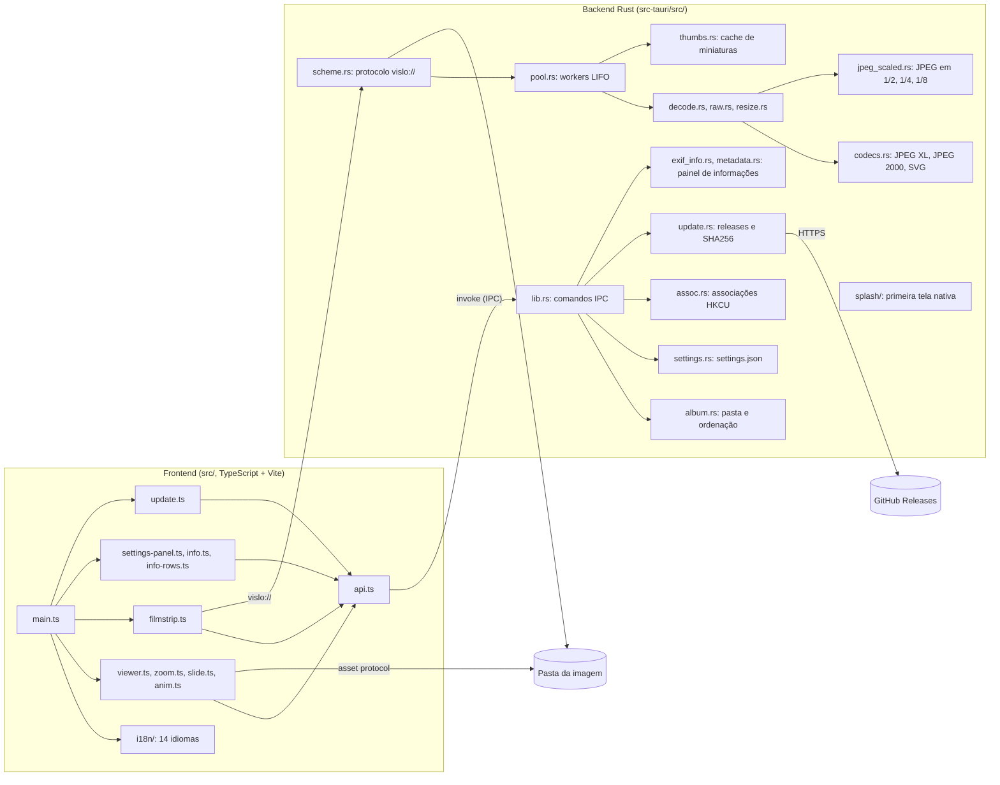

### Idiomas

Os textos ficam em `src/i18n/`: `en.ts` é a fonte de verdade e cada idioma é um módulo carregado só quando escolhido (o inglês
não carrega nada extra). Para adicionar um idioma: copie `en.ts` para `<código>.ts`, traduza, inclua o código em `LOCALES`
(`core.ts`), no `loaders` (`index.ts`) e em `LANGUAGES` (`settings.rs`); o teste `i18n.test.ts` falha se faltar uma chave ou
um `{placeholder}`. Mensagens de erro do backend Rust e o menu da bandeja continuam em inglês.

<table>
<tr>
<td width="33%">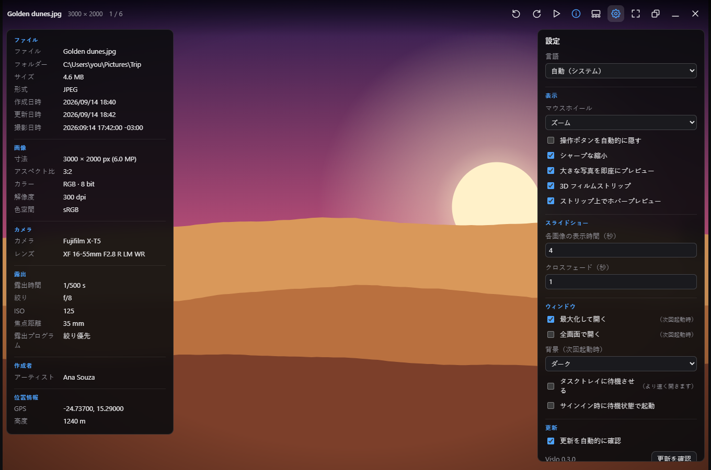<br/><b>日本語</b></td>
<td width="33%">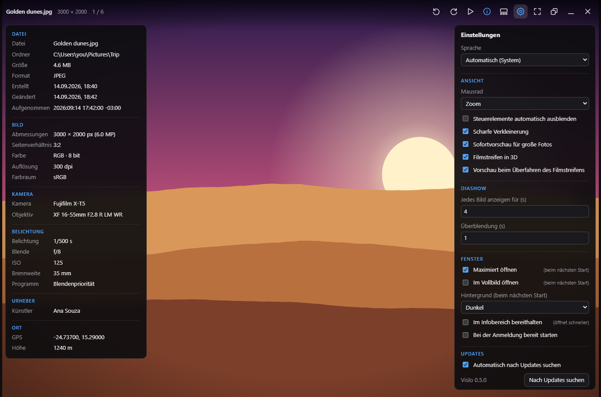<br/><b>Deutsch</b></td>
<td width="33%">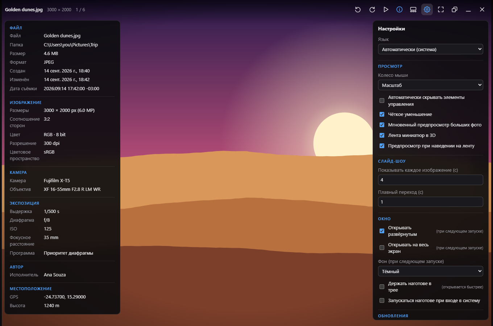<br/><b>Русский</b></td>
</tr>
</table>

## Atualização automática

O Vislo se atualiza a partir das releases deste repositório:

```
início / a cada 6 h ──► GET releases/latest ──► tag mais nova? ──► banner "Vislo <nova versão> is available"
                                                                          │ Update & restart
   novo Vislo inicia ◄── instalação silenciosa ◄── SHA256 confere? ◄── baixa Vislo_<versão>_x64-setup.exe
```

* A verificação roda alguns segundos depois da primeira imagem aparecer, então nunca atrasa a abertura. Dá para
  desligar em *Settings &rarr; Updates*; *Check for updates* verifica sob demanda.
* O instalador é baixado por HTTPS apenas deste repositório e comparado com o `SHA256SUMS.txt` da release; se não
  bater, é descartado.
* Cópias portáteis não conseguem se substituir, então o banner oferece o botão *Download* para a página da release.

### Todo commit em `main` vira uma release

O `.github/workflows/release.yml` transforma cada push em `main` numa release, sem passos manuais:

1. O CI roda (testes, build, clippy).
2. A próxima versão é calculada pelos [commits semânticos](AGENTS.md) desde a **maior** tag `vX.Y.Z` já incluída em
   `main` (não a mais próxima no histórico, que pode ser menor)
   (`feat` &rarr; minor, `fix` e demais &rarr; patch, `!` / `BREAKING CHANGE` &rarr; major).
3. O instalador e o exe portátil são construídos e o `SHA256SUMS.txt` é escrito.
4. `chore(release): vX.Y.Z` é commitado, tagueado `vX.Y.Z` e uma release do GitHub é publicada com notas por tipo.
5. As cópias em execução veem a release e oferecem a atualização.

As releases são serializadas (um push novo espera a anterior terminar); se a release anterior já incluiu o commit do run
que estava na fila, ele não publica nada e termina verde. Se o commit de versão não puder ser
enviado a `main` (conflito ou branch protegida), a tag e a release saem no commit que foi construído e o job avisa.

#### Conferir uma release

```sh
gh release view --json tagName,assets -q '.tagName, (.assets[].name)'   # Vislo_<v>_x64-setup.exe, ..-portable.exe, SHA256SUMS.txt
curl -fsSLO https://github.com/juninmd/vislo/releases/latest/download/SHA256SUMS.txt
curl -fsSLO https://github.com/juninmd/vislo/releases/latest/download/Vislo_<versão>_x64-setup.exe
sha256sum -c --ignore-missing SHA256SUMS.txt        # o mesmo teste que o app faz antes de instalar
node scripts/release.mjs plan                       # a versão que o próximo push em main publicaria
```

## Atalhos de teclado e mouse

| Entrada | Ação |
|---|---|
| Roda, pinça | zoom no cursor, de **1%** a **10.000%** dos pixels da imagem |
| `+` `-`, `↑` `↓` | zoom em passos de 15%; tecla segurada para no ajuste e em 100% |
| `Shift` + roda, deslize horizontal | imagem anterior / próxima (a roda pode navegar nas configurações; `Ctrl` + roda sempre dá zoom) |
| `←` `→`, `PageUp` `PageDown`, `Space`, `Backspace`, setas na tela | imagem anterior / próxima |
| `Ctrl` + `←` `→` | pula 10 imagens |
| `J` / `K` | imagem anterior / próxima |
| `Home` / `End` | primeira / última imagem |
| Duplo clique, `1` | alterna ajustar ↔ pixels reais (100%) |
| `0` | ajustar à janela |
| Arrastar | move a imagem em qualquer zoom |
| Arrastar / duplo clique na barra superior | mover a janela / maximizar ↔ janela |
| `Ctrl+C` | copia a imagem para a área de transferência |
| `O`, `Ctrl+O` | abrir uma imagem (diálogo de arquivo) |
| Botão direito | menu: copiar, abrir, mostrar na pasta, abrir com, info, apresentação, … |
| `R` / `Shift+R` | gira a visualização no sentido horário / anti-horário |
| `T` | filmstrip |
| `I` | painel de informações |
| `S` / `F5` | apresentação de slides |
| `F` / `F11` | tela cheia |
| `Esc` | fecha painéis, para a apresentação, sai da tela cheia e, por fim, fecha |

## Por que é rápido

* As imagens carregam direto do disco pelo protocolo de assets do Tauri, sem base64 via IPC.
* A decodificação ocorre fora da thread principal (`img.decode()`); as próximas 4 e as 2 anteriores ficam decodificadas,
  com viés para a direção do movimento.
* Miniaturas e prévias de JPEG grandes são decodificadas já reduzidas (1/2, 1/4 ou 1/8 no domínio da DCT) quando a
  redução é de 4× ou mais, e o redimensionamento reaproveita o buffer em vez de copiar a imagem inteira.
* A navegação é "o último vence": segurar uma seta nunca enfileira trabalho obsoleto.
* Miniaturas, prévias e conversões de formato rodam num pequeno pool de workers LIFO, então a imagem que você está
  vendo sempre é atendida antes do backlog.

Comparação com outros visualizadores e as medições por trás dessas escolhas: [BENCHMARK.md](BENCHMARK.md).

## Configuração

As preferências ficam em `settings.json`, na pasta de configuração do app (`app_config_dir` do Tauri), e são editadas
pelo painel de configurações (ícone de engrenagem), inclusive o idioma (`language`: `auto` ou um código como `pt-BR`).
O app não lê variáveis de ambiente.

## Desenvolvimento

Requer Node 20+ (o CI usa Node 22), Rust stable e os
[pré-requisitos do Tauri](https://tauri.app/start/prerequisites/) para Windows (WebView2, MSVC build tools).

```sh
npm install                                     # também instala o hook commit-msg (commits semânticos)
npm test                                        # testes unitários do frontend e das ferramentas de release (vitest)
npm run build                                   # tsc --noEmit + vite build
pwsh scripts/ci-local.ps1                       # tudo o que o pipeline de CI roda
cargo test --manifest-path src-tauri/Cargo.toml # testes do backend
cargo clippy --manifest-path src-tauri/Cargo.toml -- -D warnings
cargo test --manifest-path src-tauri/Cargo.toml --profile devrel bench_ -- --ignored --nocapture   # benchmark de decodificação (ver BENCHMARK.md)
npm run tauri dev                               # frontend com hot reload, estado vazio (solte um arquivo)
npm run tauri build                             # instalador NSIS com associações de arquivo de imagem
npm run screenshots                             # regenera assets/screenshots (Chromium headless, backend simulado)
npm run perf:ui                                 # mede layouts, recálculos de estilo e quadros lentos num cenário fixo de UI
npm run icons                                   # regenera icon.ico e os PNGs de src-tauri/icons a partir de app-icon*.svg
npm run check:commits                           # valida os commits de origin/main..HEAD
cargo build --profile devrel --features tauri/custom-protocol --manifest-path src-tauri/Cargo.toml  # build otimizado rápido (sem LTO) para trabalho de desempenho
.\src-tauri\target\release\vislo.exe "C:\caminho\para\imagem.jpg"
```

Fotos para teste manual (EXIF, rotacionadas, PSD, RAW) podem ser geradas com
`VISLO_FIXTURES=<dir> cargo test --manifest-path src-tauri/Cargo.toml write_fixtures -- --ignored`.

O app não lê variáveis de ambiente para configuração; `VISLO_FIXTURES` só é usada por esse teste.

## Gates de CI

| Workflow | Quando | O que checa |
|---|---|---|
| `ci.yml` (`ci`) | pull request, manual e chamado pelo release | job `commits`: título do PR e cada commit seguem Conventional Commits; job `check` (Windows): `npm ci`, `npm test`, `npm run build`, `cargo test`, `cargo clippy -D warnings` |
| `release.yml` (`release`) | push em `main` | roda o `ci`, calcula a versão, constrói instalador e exe portátil, escreve `SHA256SUMS.txt`, commita `chore(release)`, tagueia e publica a release |
| `validate.yml` (`Validate`) | pull request e push em `main` | validação reutilizável de `juninmd/base-actions` (`reusable-validate.yml`) |
| `security.yml` (`Security Scan`) | push em `main`, manual e semanal (domingo 00:00 UTC) | varredura de segurança reutilizável de `juninmd/base-actions` (`reusable-security-scan.yml`) |

## Contribuindo

Mensagens de commit e títulos de PR devem seguir [Conventional Commits](https://www.conventionalcommits.org): o hook, o
CI e o planejador de release dependem disso. As regras, as regras de release e as convenções de código estão em
[AGENTS.md](AGENTS.md).

## Segurança

* O escopo do asset protocol começa vazio e é ampliado em runtime para o **diretório único** da imagem aberta (sem recursão).
* O protocolo `vislo://` de miniaturas e conversões só serve arquivos de imagem dentro de uma pasta aberta; todo caminho
  é canonicalizado antes (path traversal e arquivos que não são imagem recebem 403).
* CSP estrita; só as permissões de tamanho da janela, tela cheia, título e fechar são concedidas ao webview.
* As alterações de registro para associações de arquivo são apenas por usuário (`HKCU`).
* As atualizações vêm apenas das releases do GitHub deste repositório, por HTTPS, e o instalador é conferido contra o
  `SHA256SUMS.txt` da release antes de ser executado.

## Limitações conhecidas

* Só Windows x64 com WebView2. Não há build para macOS ou Linux.
* Não edita, não organiza biblioteca e não importa: o escopo é ver a imagem.
* Arquivos RAW são exibidos pelo JPEG de prévia embutido no arquivo, não pela revelação do sensor.
* Imagens enormes ou corrompidas são recusadas com mensagem. JPEG XL e JPEG 2000 mostram o primeiro quadro e são lidos por
  completo na memória (limite de 150 milhões de pixels). HEIC/HEIF ainda não é suportado (licença e custo de build, ver #32).
* SVG pequeno é ampliado para ao menos 1024 px no maior lado; o zoom reutiliza o raster do tamanho ajustado, então zooms muito
  grandes em SVG podem ficar suaves.
* Cópias portáteis não se atualizam sozinhas; o banner leva à página da release.
* O instalador não é assinado (ver [Instalação](#instalação)).

## Licença

Distribuído sob a licença [MIT](LICENSE). Copyright (c) 2026 Antonio Carlos.
